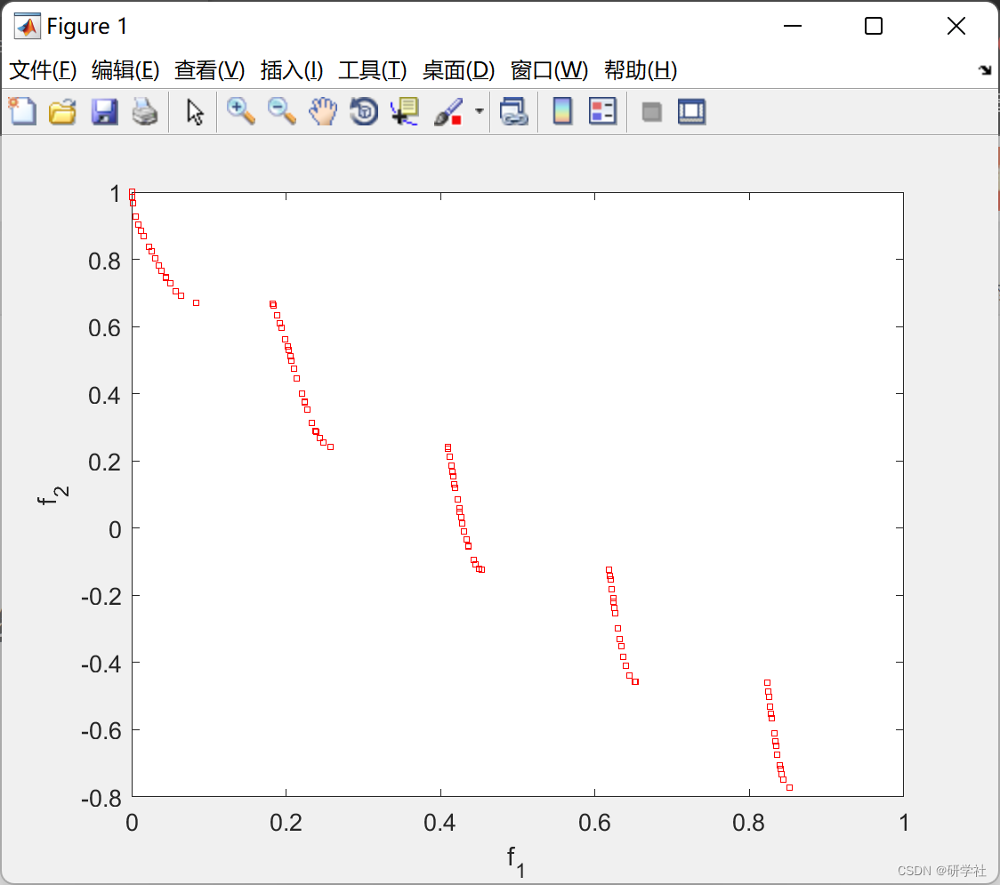
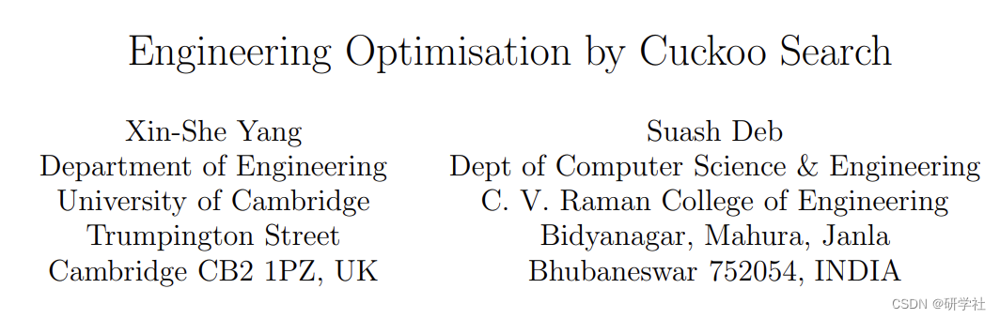

# Multi-Object Turtle Search Optimization Algorithm (Matlab Code Implementation)

🏆 Bloggers' Advantages: 🌞🌞🌞 The content of the blog strives for rigorous thinking and clear logic to facilitate readers.
⛳️ Mantra: A journey of a thousand miles is begun with a single step. 
💥1 Overview📚 The majority of design optimization problems in engineering are highly nonlinear, involving numerous different design variables under complex constraints. These constraints can be written as simple boundaries, such as material property ranges, or as nonlinear relationships, including maximum stress, maximum deflection, minimum load capacity, and geometric configurations. Such nonlinearity often leads to multimodal responses. Subsequently, local search algorithms (such as hill climbing and Nelder-Mead downhill simplex method) are not applicable, and only global algorithms should be used to obtain the optimal solution.
Yang and Deb (2009) developed a new metaheuristic optimization algorithm called Cuckoo Search (CS). This paper conducts a broader comparative study using some standard test functions and newly designed random test functions. Then, we apply the CS algorithm to solve engineering design optimization problems, including the design of spring and welded beam structures. The optimal solution obtained by the CS far surpasses the best solution obtained by the efficient particle swarm optimization algorithm. We will discuss the unique search features used in the CS and its implications for further research.
📚2 Running Results​Edit
Part of the code:  
for j = 1:n,  
s = nest(j,:);  
%% Levy flights by Mantegna's algorithm  
u = randn(size(s)) * sigma;  
v = randn(size(s));  
step = u./abs(v).^(1/beta);  
stepsize = 0.1*step.*(s-best);  
% Now the actual random walks or flights
s=s+stepsize.*randn(size(s));  
% Apply simple bounds/limits  
nest(j,:)=simplebounds(s,Lb,Ub);  
end  
%% Replace some nests by constructing new solutions/nests  
function new_nest=empty_nests(nest,Lb,Ub,pa)  
% A fraction of worse nests are discovered with a probability pa  
[n,d]=size(nest);  
% The solutions represented by cuckoos to be discovered or not  
% with a probability pa. This action is implemented as a status vector  
K=rand(size(nest))>pa;  
%% New solution by biased/selective random walks  
stepsize=rand(1,d).*(nest(randperm(n),:)-nest(randperm(n),:));  
new_nest=nest+stepsize.*K;  
for j=1:size(new_nest,1)  
s=new_nest(j,:);  
new_nest(j,:)=simplebounds(s,Lb,Ub);  
end  
% Application of simple bounds  
function s=simplebounds(s,Lb,Ub)  
% Apply the lower bound  
ns_tmp=s;  
I=ns_tmp<Lb;  
ns_tmp(I)=Lb(I);  
% Apply the upper bounds  
J=ns_tmp>Ub;  
ns_tmp(J)=Ub(J);  
% Update this new move  
s=ns_tmp;  
%%%%%%%%%%%%%%%%%%%%%%%%%%%%%%%%%%%%%%%%%%%%%%%%%%%%%%%%%%%%%%%%%%%%%%%%%%%  
%% Objective functions  
function f = obj_funs(x, m)  
% Zitzler-Deb-Thiele's funciton No 3 (ZDT function 3)  
% M = # of objectives  
% d = # of variables/dimensions  
d=length(x); % d=30 for ZDT 3  
% First objective f1  
f(1) = x(1);  
g=1+9/29*sum(x(2:d));  
h=1-sqrt(f(1)/g)-f(1)/g*sin(10*pi*f(1));  
% Second objective f2  
f(2) = g*h;  
%%%%%%%%%%%%%%%%%% end of the definitions of obojectives %%%%%%%%%%%%%%%%%%  
function new_Sol = Select_pop(nest, m, ndim, npop)  
% The input population to this part has twice (ntwice) of the needed  
% population size (npop). Thus, selection is done based on ranking and  
% crowding distances, calculated from the non-dominated sorting  
ntwice= size(nest,1);  
% Ranking is stored in column Krank  
Krank=m+ndim+1;  
% Sort the population of size 2*npop according to their ranks  
[~,Index] = sort(nest(:,Krank)); sorted_nest=nest(Index,:);  
% Get the maximum rank among the population  
RankMax=max(nest(:,Krank));  
🎉3 References
🌈4 Matlab Code and Article Reading

## Images

<!-- PAYMENT_BLOCK -->

## Get this dataset

- Payment link (Stripe): [Buy now](https://buy.stripe.com/3cs8yP7sY87d0vu9AB)
- Payment QR code: 

<!-- /PAYMENT_BLOCK -->
